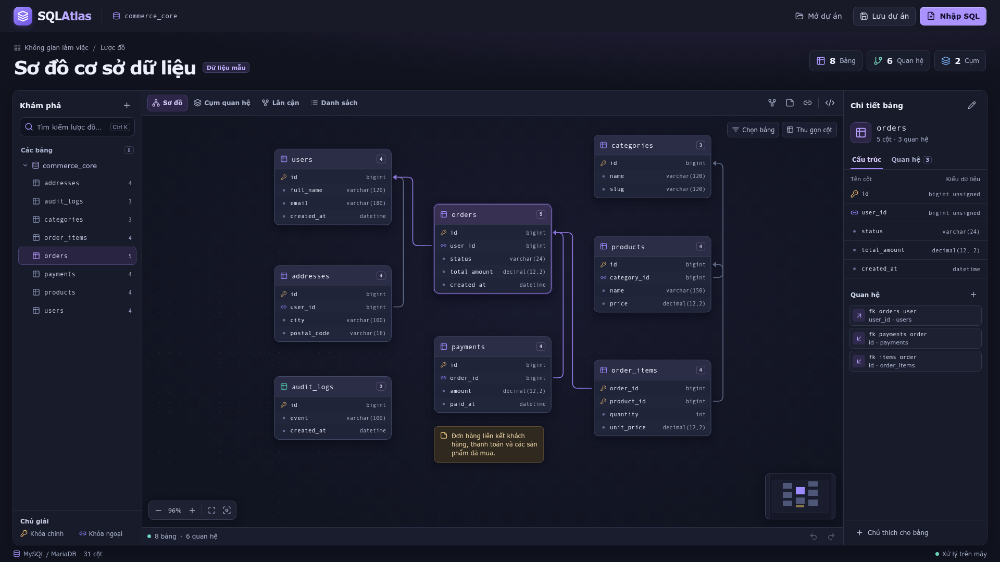

# SQL Atlas

SQL Atlas là ứng dụng web để tìm kiếm, trực quan hóa và chỉnh sửa lược đồ MySQL/MariaDB. Nhập file `.sql` hoặc dán SQL để khám phá bảng, cột, khóa ngoại và các cụm quan hệ. [Mở SQL Atlas trên Firebase Hosting](https://sql-atlas-hwe6md.web.app/)



## Chức năng

- **Tìm kiếm lược đồ.** Nhấn `Ctrl+K` để tìm theo database, tên bảng, cột hoặc khóa ngoại. Kết quả khớp tên được ưu tiên. Khi chọn kết quả, ứng dụng đưa đối tượng vào khung nhìn và tô sáng cột hoặc đường quan hệ tương ứng.
- **Khám phá quan hệ.** Xem toàn bộ sơ đồ, các cụm bảng nối với nhau qua khóa ngoại, các bảng lân cận trong 1–3 bước hoặc danh sách bảng. Công cụ **Tìm đường liên kết** tô sáng đường đi ngắn nhất giữa hai bảng.
- **Chọn bảng và bố trí.** Dùng **Chọn bảng** để chỉ hiện những bảng cần xem và các đường nối giữa chúng. Kéo thả từng bảng, thu gọn cột, thu phóng, dùng bản đồ thu nhỏ hoặc tự sắp xếp các bảng đang hiện.
- **Nhập SQL.** Tải file `.sql`, kéo thả file hoặc dán SQL từ MySQL/MariaDB. Bộ nhập đọc `CREATE TABLE`, các biến thể `ALTER TABLE` thường gặp, chỉ mục và khóa ghép. Ứng dụng bỏ qua dữ liệu hàng và báo số dòng cho cú pháp cấu trúc chưa hỗ trợ.
- **Chỉnh sửa lược đồ.** Thêm, sửa, xóa bảng và cột. Tạo hoặc chỉnh sửa khóa ngoại bằng biểu mẫu, hoặc kéo từ cột nguồn đến cột đích để điền sẵn tham chiếu. Có kiểm tra kiểu dữ liệu, hỗ trợ khóa ngoại nhiều cột và hoàn tác/làm lại.
- **Chú thích sơ đồ.** Chọn một bảng rồi bấm **Thêm chú thích** để ghim ghi chú vào bảng đó. Chú thích di chuyển cùng bảng. Trong hộp thoại có thể chọn bảng khác hoặc đặt ghi chú tự do trên canvas.
- **Lưu dự án và xuất SQL.** File `.sqlviz.json` lưu lược đồ đã sửa, chú thích, vị trí bảng, bộ lọc và khung nhìn để tiếp tục ở lần mở sau. **Xuất SQL** tạo tập lệnh dựng lại bảng, chỉ mục và khóa ngoại trên cơ sở dữ liệu trống.

## Bắt đầu

1. Dùng **Nhập SQL** để mở lược đồ của bạn hoặc khám phá dữ liệu mẫu trên trang chủ.
2. Tìm bảng cần xem, chọn các bảng liên quan và sắp xếp sơ đồ.
3. Chọn **Lưu dự án** để tiếp tục chỉnh sửa sau hoặc **Xuất SQL** để lấy cấu trúc đã sửa.

## Chạy trên máy

Yêu cầu Node.js 22.12 trở lên và npm.

```sh
npm ci
npm run dev
```

Mở [http://127.0.0.1:5173](http://127.0.0.1:5173/). Chạy `npm test` để kiểm tra bộ nhập SQL, tìm kiếm, đồ thị quan hệ và định dạng file dự án.

## Firebase Hosting

Firebase Hosting phục vụ các file tĩnh đã build trong `dist/`. File SQL và file dự án do trình duyệt xử lý. Bản trực tuyến dùng dự án Firebase `sql-atlas-hwe6md`.

Với Firebase CLI đã đăng nhập và có quyền triển khai dự án, build rồi xuất bản với hai lệnh sau. [Hướng dẫn Firebase Hosting](https://firebase.google.com/docs/hosting/quickstart)

```sh
npm run build
firebase deploy --only hosting --project sql-atlas-hwe6md
```
